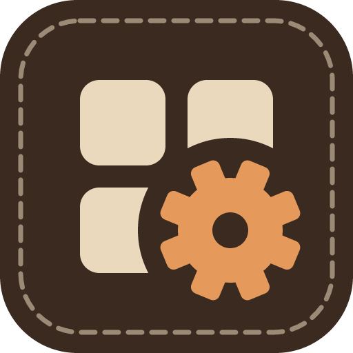

# Forever Enhanced

A lightweight utility addon for Forever. It keeps the default UI familiar while adding a handful of practical quality-of-life improvements, all of which are highly configurable and can be deactivated.

&nbsp;

## Features

- Item locking to protect items from being moved, sold, etc
- Automatic quest tracking by zone or distance, so you always track what is closest to you
- Movable windows and bags
- A seamless world map you can zoom and pan across zones, continents and the whole world
- See your bank and your alts' banks from anywhere
- Auction house prices in item tooltips
- Automatic junk selling and repairs at merchants
- Show how much health your damage over time effects will still take on enemy health bars

&nbsp;

## And also

- Show the crafting recipes of items in their tooltip (press shift)
- Mark items as junk, for the bank or the auction house, and write notes on them (alt right click)
- Show which quest an item belongs to in its tooltip, and which ones you don't need anymore
- Show sparkles around interactable quest items in the world
- Make the nearest herb, ore or quest object glow
- Show your chance to gain skill on recipes, herbs, ore and skinning
- Quick bank deposit and withdraw, and refill your stacks from the bank
- Spot the cheapest items in your bags when you need to make room
- Quest objective announcements to your group (or hide Questie's and Polestar's)
- A search box at merchants
- Combo points on enemy nameplates
- Swap a spell for another on your action bars when it can be cast, like Ambush with Ghostly Strike for rogues
- Spell ranks on your action bars upgrade when you learn a new one
- Easier macro management: icon search, duplicating, hiding macro names on your bars
- Support for TomTom's `/way` coordinates from guides
- Show your friends on the world map (supports OpenMap too)
- See your layer above the minimap, and swap to another from your portrait's menu (works with LayerSwap users)

All of those features can be enabled or disabled individually. The ones that change your game the most are disabled by default, and presets let you turn everything on at once if you want.

&nbsp;

## Fewer addons

If you install a large addon for only one or two of its features, Forever Enhanced may cover them on its own:

- **OpenMap**, **Mapster**, **Leatrix Maps**: seamless world map, unexplored areas
- **Bagnon**, **Baganator**, **BagSync**, **Altoholic**: your characters' banks from anywhere, bank counts in tooltips
- **Auctionator**, **Auctioneer**: auction prices in tooltips
- **Scrap**, **Peddler**, **Dejunk**: junk marking and automatic selling
- **BankStack**: refilling stacks from the bank
- **BlizzMove**, **Forever Move**, **MoveAnything**: movable windows
- **Leatrix Plus**: automatic repairs and junk selling, movable windows
- **Questie**: nearby quest tracking, quest item sparkles, objectives in tooltips, objective announcements
- **TomTom**: `/way` commands from guides
- **Does It Die?**, **DoT Lethal**: the damage your DoTs will still deal, on health bars
- **LayerSwap**: your current layer, layer swaps with LayerSwap's own hosts
